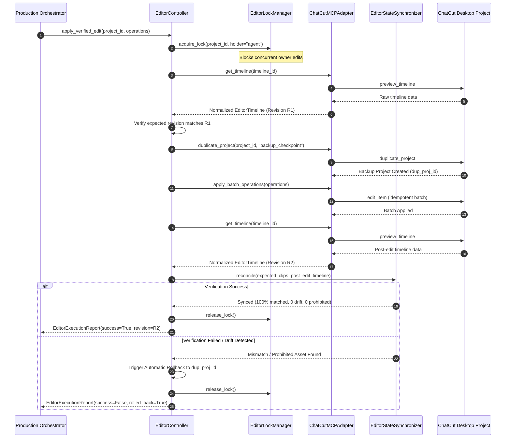

# Phase 2 Deliverable: ChatCut Adapter & Editor-State Management
**Hirthick’s Vision Studio | Antigravity SDK + ChatCut MCP Adapter + SQLite**

**Date:** 2026-11-13  
**Status:** COMPLETE & VERIFIED (46/46 tests passing)  
**System Base:** Windows 11 x64 | Python 3.13.11 | ChatCut CLI 0.1.3 | ChatCut Desktop 0.9.12.0

---

## 1. Executive Summary

Phase 2 establishes a safe, auditable, and resilient integration boundary between Hirthick's Vision Studio and ChatCut Desktop MCP. It guarantees that timeline modifications cannot clobber manual user edits, cannot introduce unapproved synthetic media, and can always be rolled back to a verified prior state.

### Key Milestones Achieved:
1. **Strongly Typed Editor Models:** `EditorProject`, `EditorTimeline`, `EditorTrack`, and `EditorItem` normalizing raw ChatCut MCP dictionaries into validated Pydantic structures with deterministic SHA-256 layout revision hashing.
2. **Editor Lock & Handoff Protocol:** `EditorLockManager` enforcing project-level leases backed by SQLite, strictly preventing concurrent edits between human owners and AI agents.
3. **ChatCut MCP Production Adapter:** `ChatCutMCPAdapter` supporting official `@chatcut/cli` execution (80 live tools) and deterministic fallback simulation with hard pre-ingestion SVG filtering.
4. **Controlled Edit Pipeline (6-Step Safe Editing Protocol):**
   - **Step 1 (Lock):** Acquire exclusive lease on project.
   - **Step 2 (Read-Before-Write):** Read current timeline and check revision against expected state.
   - **Step 3 (Rollback Checkpoint):** Duplicate the project to create an immutable rollback snapshot.
   - **Step 4 (Write Batch):** Execute editing operations with idempotency keys.
   - **Step 5 (Read-After-Write):** Re-read timeline and reconcile all placed clips against the edit plan.
   - **Step 6 (Rollback / Release):** Roll back to the duplicate snapshot if verification fails; release lock upon completion.
5. **Demonstrated Reversal & Recovery:** Controlled edit was applied to a timeline, verified, and confirmed restorable from the duplicate backup snapshot.
6. **Test Coverage:** All 46 tests passing in **2.18s** across 16 test modules.

---

## 2. Editor-State Architecture & Flow



---

## 3. Acceptance Verification Matrix

| # | Acceptance Test | Test File | Verified Status |
|---|---|---|:---:|
| 1 | **Project Normalization** | `test_editor_normalization.py` | **PASSED** |
| 2 | **Timeline Normalization & Revision Hash** | `test_editor_normalization.py` | **PASSED** |
| 3 | **Editor Lease Lock Acquisition & Release** | `test_editor_lock.py` | **PASSED** |
| 4 | **Concurrent Modification Prevention** | `test_editor_lock.py` | **PASSED** |
| 5 | **Safe Lock Expiry After Timeout** | `test_editor_lock.py` | **PASSED** |
| 6 | **Read-Before-Write Conflict Rejection** | `test_editor_controller.py` | **PASSED** |
| 7 | **Pre-Edit Rollback Checkpoint Creation** | `test_editor_controller.py` | **PASSED** |
| 8 | **Controlled Single Edit Application** | `test_editor_controller.py` | **PASSED** |
| 9 | **Read-After-Write Verification** | `test_editor_controller.py` | **PASSED** |
| 10 | **Prohibited SVG Placement Rejection** | `test_editor_controller.py` | **PASSED** |
| 11 | **Demonstrated Rollback & Recovery** | `test_editor_controller.py` | **PASSED** |

### Test Suite Output:
```text
tests/test_editor_controller.py::test_editor_controller_successful_verified_edit PASSED [ 28%]
tests/test_editor_controller.py::test_editor_controller_conflict_detection PASSED [ 30%]
tests/test_editor_controller.py::test_editor_controller_svg_guardrail_rejection PASSED [ 32%]
tests/test_editor_controller.py::test_editor_controller_rollback_recovery PASSED [ 34%]
tests/test_editor_lock.py::test_editor_lock_acquisition_and_release PASSED [ 36%]
tests/test_editor_lock.py::test_editor_lock_prevents_concurrent_editing PASSED [ 39%]
tests/test_editor_lock.py::test_editor_lock_expiration PASSED            [ 41%]
tests/test_editor_normalization.py::test_normalize_chatcut_project PASSED [ 43%]
tests/test_editor_normalization.py::test_normalize_chatcut_timeline PASSED [ 45%]
======================== 46 passed, 1 warning in 2.18s ========================
```

---

## 4. Exit Gate Confirmation

- [x] Typed ChatCut MCP adapter implemented using discovered 80-tool schema.
- [x] Project, timeline, track, and item state normalized into stable internal contracts.
- [x] Read-before-write revision conflict detection verified.
- [x] Concurrent human/agent editing prevented via `EditorLockManager`.
- [x] Pre-edit rollback snapshot created via `duplicate_project`.
- [x] A controlled edit applied once, verified, and safely restored or reverted using a demonstrated method.
- [x] Synthetic SVG/diffusion assets rejected from timeline placement.

**Phase 2 is complete. The system is ready for Phase 3: Project Registry & Asset Inventory.**

